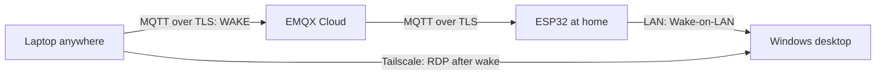

# ESP32 Remote Wake-on-LAN

Wake a sleeping Windows desktop from anywhere, then connect with Remote Desktop over Tailscale. An always-powered ESP32 at home receives a command through EMQX Cloud and sends a local Wake-on-LAN packet.



No router port forwarding is required. RDP is accessed through Tailscale and must never be exposed directly to the Internet. The ESP32 initiates its own outbound TLS connection; it has no Internet-facing command endpoint.

## Features

- Certificate-validated MQTT over TLS on the ESP32 and laptop.
- Separate MQTT identities: the ESP32 subscribes and the laptop publishes, each on one exact topic.
- Least-privilege broker authorization with a deny-all fallback.
- The ESP32 accepts only the case-sensitive `WAKE` command (surrounding whitespace is trimmed), with a 30-second cooldown and three magic packets per accepted command.
- Windows MQTT passwords are retrieved from Windows Credential Manager through `keyring`.
- Local credentials and machine configuration are excluded from Git.
- A PowerShell launcher waits up to 90 seconds for the desktop's Tailscale RDP port, then opens `mstsc.exe`.

## Status

The original installation was successfully tested end to end from a laptop connected to a mobile hotspot, including waking the desktop and connecting through Tailscale. The original firmware also passed Arduino Verify after credentials were extracted. These are operator-reported results from the project handoff on October 2, 2026; the public configuration refactor must be verified and tested on your hardware before relying on it remotely.

## Get started

You need an ESP32 Dev Module with continuous power and home Wi-Fi, an Ethernet-connected desktop with Wake-on-LAN and an RDP-capable Windows edition, a Windows laptop with Python 3.10+, an EMQX Cloud deployment, and Tailscale on both Windows computers.

Follow [setup](docs/setup.md), then run from the repository root:

```powershell
python -m pip install -r requirements.txt
python .\windows\Wake-Desktop-Internet.py
powershell.exe -NoProfile -File .\windows\Wake-And-Connect.ps1
```

Publishing successfully means the broker acknowledged the command, not that the ESP32 received it or that the desktop woke. The launcher checks RDP availability separately.

## Repository

| Path | Purpose |
| --- | --- |
| `firmware/esp32_remote_control/esp32_remote_control.ino` | ESP32 Wi-Fi, TLS, MQTT, and Wake-on-LAN |
| `firmware/esp32_remote_control/secrets.example.h` | Template for Wi-Fi and ESP32 MQTT credentials |
| `firmware/esp32_remote_control/config.example.h` | Template for broker, topic, MAC, and broadcast settings |
| `windows/config.example.json` | Template for laptop broker, keyring, and Tailscale settings |
| `windows/Wake-Desktop-Internet.py` | Publish one non-retained `WAKE` command |
| `windows/Wake-And-Connect.ps1` | Publish, wait for RDP, and launch Remote Desktop |

Copy the examples to `secrets.h`, firmware `config.h`, and Windows `config.json` respectively. The local files are ignored; public examples contain placeholders and illustrative defaults only.

## Documentation

- [Architecture and runtime behavior](docs/architecture.md)
- [Installation and verification](docs/setup.md)
- [Security model and release checks](docs/security.md)
- [Troubleshooting](docs/troubleshooting.md)

## License

[MIT](LICENSE).
